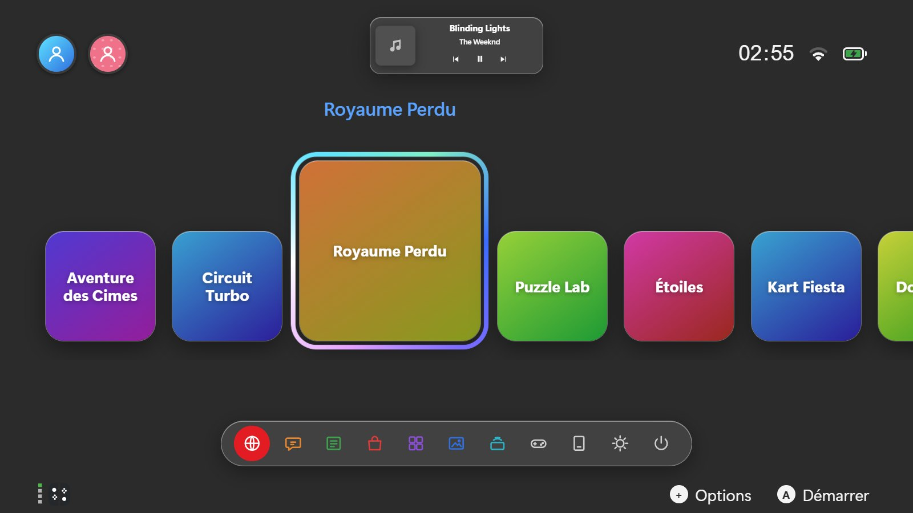
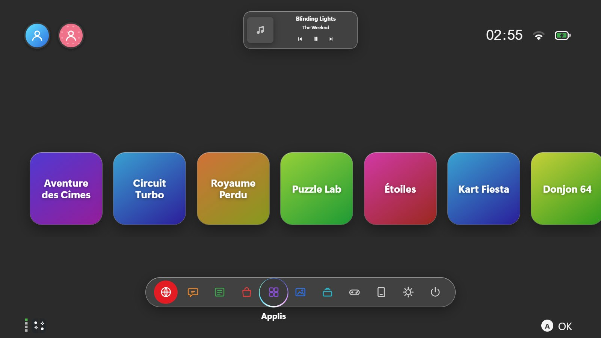
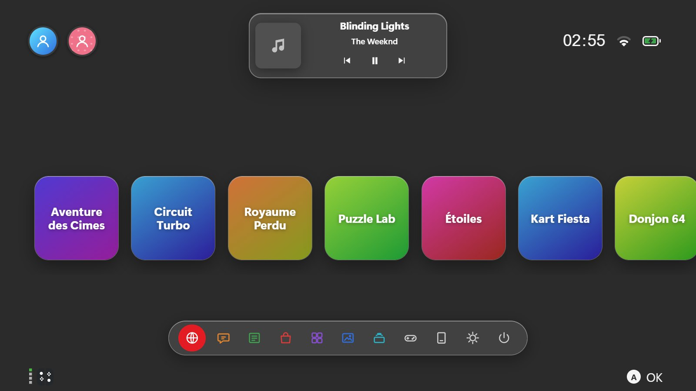
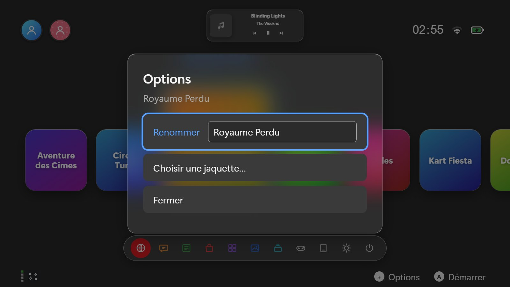
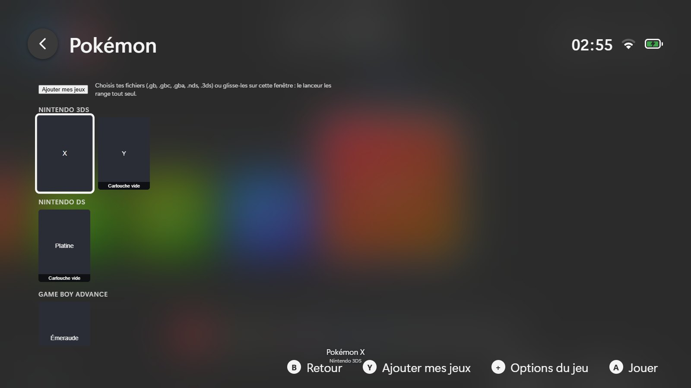
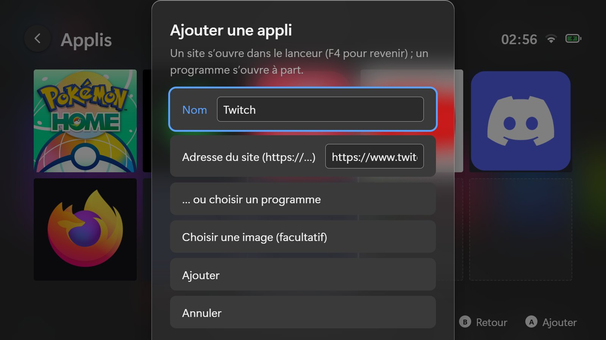
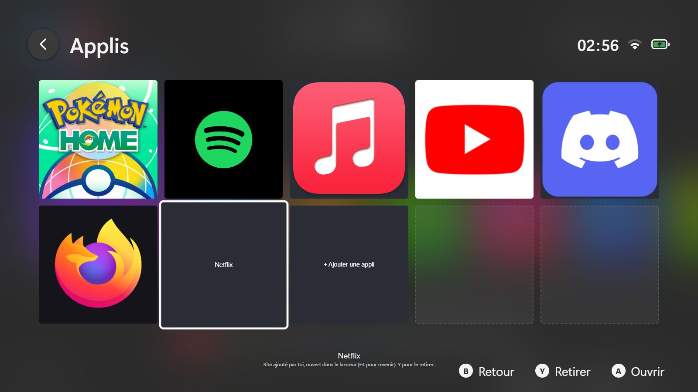
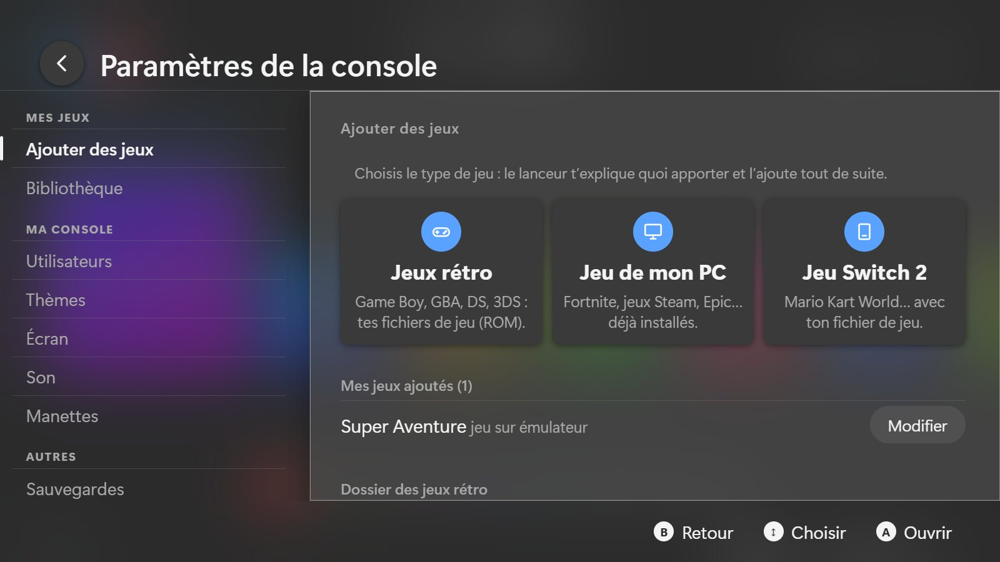
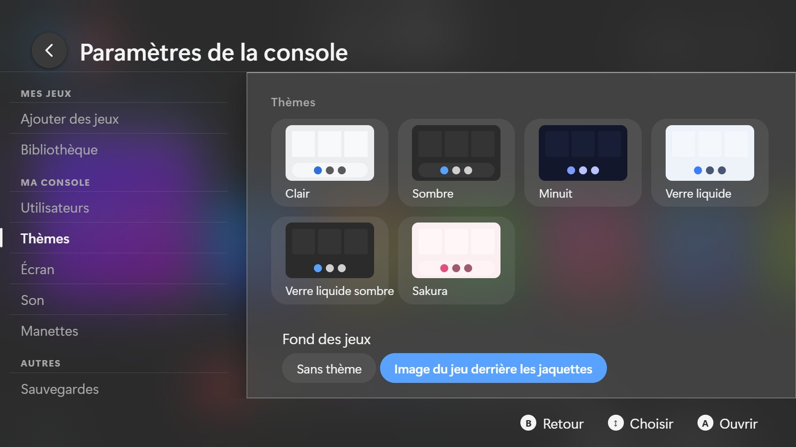

# Console Launcher

Un menu de console **plein écran** pour PC, à la manette ou au clavier : tous tes jeux (PC, rétro, Switch 2) et tes applis au même endroit, avec des profils, des thèmes, la musique en cours et Pokémon Home intégré.

Fonctionne sous **Windows** et **Ubuntu (Linux)**.

<p align="center">
  <br>
  <em>L'accueil, thème « Verre liquide sombre ».</em>
</p>

> Les captures viennent d'un aperçu de démonstration : des jeux fictifs (tuiles de couleur) remplacent les vraies jaquettes.

## Télécharger

1. Ouvre la page [**Releases**](https://github.com/FireXcorn/console-launcher/releases/latest).
2. Dans la section **Assets**, télécharge **`Console-Launcher-Windows.zip`** (Windows 10 et 11) ou **`Console-Launcher-Linux.tar.gz`** (Ubuntu).
3. Décompresse l'archive, puis lance **`Console Launcher.exe`** (Windows) ou **`Console Launcher-….AppImage`** (Linux). Rien à installer.

> **Ne télécharge pas « Source code (zip) ».** Ce fichier, que GitHub ajoute tout seul à chaque version, ne contient que le code du projet : il n'y a **aucun `.exe`** dedans. Le programme à lancer se trouve dans `Console-Launcher-Windows.zip`.

Les émulateurs (mGBA, melonDS, Azahar) et Pokémon Home (PKVault) sont livrés avec le lanceur. Les jeux ne sont pas fournis : dépose les tiens dans le dossier **`Jeux`**, à côté du programme, ou ajoute-les depuis le menu.

> **À savoir.** Console Launcher est un projet indépendant. Il n'est ni affilié ni approuvé par Nintendo ou par un autre constructeur de consoles, et il ne contient aucun jeu ni fichier de console. Les émulateurs mGBA, melonDS et Azahar sont livrés avec leur propre licence. Les noms de marques cités dans la documentation appartiennent à leurs propriétaires.

## L'accueil

- Une tuile par jeu ; la sélection glisse d'une tuile à l'autre.
- En haut : les profils, le **mini lecteur de musique**, l'heure, le Wi-Fi et la batterie.
- En bas : la barre d'accès (Actualités, Applis, Album, Manettes, Paramètres, Veille…). Le nom de l'icône sélectionnée s'affiche dessous.

<p align="center">
  
</p>

### Mini lecteur de musique

Il apparaît dès que **Spotify** ou **Apple Music** joue (sous Linux : Spotify).

- Il grandit quand la souris passe dessus ou que la manette le sélectionne.
- **A** ou un clic ouvre l'appli de musique.
- Précédent / pause / suivant : boutons du lecteur, ou **L / R / Y** à la manette.

<p align="center">
  
</p>

### Options d'un jeu

**+** à la manette (ou **Tab** au clavier) sur un jeu : le renommer, lui choisir une jaquette (une image de ton PC), extraire sa sauvegarde ou le retirer.

<p align="center">
  
</p>

## Pokémon

Tous les jeux Pokémon sont rangés sous une seule tuile **Pokémon**, classés par console (Game Boy, GBA, DS, 3DS).

- **Y** : ajouter tes fichiers de jeu (`.gb`, `.gbc`, `.gba`, `.nds`, `.3ds`), ou glisse-les sur la fenêtre.
- **+** (ou **Tab**) : options du jeu, comme sur l'accueil.

<p align="center">
  
</p>

### Pokémon Home (PKVault)

Dans **Applis**. Il range tes Pokémon dans des boîtes et les fait passer d'un jeu à l'autre.

- Les sauvegardes des émulateurs sont **reconnues automatiquement** : rien à régler. Sauvegarde dans le jeu (Menu → Sauvegarder), quitte, puis ouvre Pokémon Home : tes Pokémon y sont.
- En quittant un jeu, le lanceur garde aussi une copie de secours de sa sauvegarde.
- PKVault garde une copie de tes sauvegardes avant chaque transfert.

## Applis

Pokémon Home, Spotify, Apple Music, YouTube, Discord, Firefox… Les sites (YouTube, Discord) s'ouvrent **dans** le lanceur. Pour revenir : le bouton « Retour au lanceur », **F4** (ou Maj + F4) ou le bouton View de la manette.

<p align="center">
  
</p>

### Ajouter tes propres applis

La case **+ Ajouter une appli** : donne un nom, puis :

- **l'adresse d'un site** (`https://…`) : il s'ouvre dans le lanceur, comme Discord ;
- **ou un programme** de ton ordinateur (`.exe` sous Windows) : il s'ouvre à part.

Tu peux aussi choisir une image. **Y** sur une appli ajoutée la retire (le programme lui-même n'est pas supprimé).

<p align="center">
  <br>
  
</p>

## Paramètres

Rangés en trois groupes : **Mes jeux**, **Ma console**, **Autres**.

**Ajouter des jeux** propose trois cartes :

- **Jeux rétro :** Game Boy, GBA, DS, 3DS (tes fichiers de jeu) ;
- **Jeu de mon PC :** le lanceur trouve tes jeux installés (Microsoft Store / Xbox, Steam, Epic Games) ;
- **Jeu Switch 2 :** avec ton propre fichier de jeu.

<p align="center">
  
</p>

### Thèmes

Clair, Sombre, Minuit, **Verre liquide**, **Verre liquide sombre**, Sakura. Tu peux aussi créer ton thème (fond d'écran, couleurs, sons) et afficher la grande image du jeu sélectionné derrière les jaquettes. → [Personnalisation](docs/personnalisation.md)

<p align="center">
  
</p>

## Commandes

| Action | Manette | Clavier |
|---|---|---|
| Se déplacer | Croix / stick | Flèches |
| Valider | A | Entrée |
| Retour | B | Échap / Retour arrière |
| Options du jeu | + | Tab |
| Musique : précédent / suivant | L / R | Page préc. / Page suiv. |
| Musique : pause / lecture | Y | Suppr |
| Revenir d'un site ou de Pokémon Home | View | F4 (ou Maj + F4) |
| Revenir au menu depuis un jeu | Retour + Menu maintenus 2 s | Ctrl+Alt+Q |
| Plein écran | | F11 |

## Version Linux (Ubuntu)

Le lanceur existe aussi pour **Ubuntu** (fichier AppImage, dans `Console-Launcher-Linux.tar.gz`). Les jeux sur émulateur (Game Boy, Game Boy Color, GBA, DS, 3DS) fonctionnent, avec mGBA, melonDS et Azahar déjà livrés. Les jeux Switch 2 sont des programmes Windows : ils restent visibles mais portent la mention rouge **« Indisponible sur Linux »**. Le mini lecteur suit Spotify.

Dépose tes jeux dans le dossier `Jeux`, à côté de l'AppImage. Détails : [Installation](docs/installation.md#sous-linux-ubuntu). Le lanceur Linux n'a été essayé que dans une machine virtuelle.

## Ce qui est inclus, et ce qui ne l'est pas

Le lanceur est **un menu** : il lance **tes** jeux. Il fonctionne avec :

| Type | Exemples | Ce que tu fournis |
|---|---|---|
| Jeux PC natifs | Un dossier avec un `.exe` | Le dossier du jeu |
| Jeux sur émulateur | Tout émulateur qui se lance en ligne de commande | L'émulateur (site officiel) et le fichier de **ton** jeu |
| Jeux issus d'une recompilation / d'un portage | Un programme PC produit par un outil dédié | Le programme obtenu à partir de **ta** copie du jeu |
| **Jeux livrés avec leur outil** | Mario Kart World, Donkey Kong Bananza, Pokémon Pokopia, Zelda Ocarina of Time : l'outil est déjà dans l'archive | Seulement **ton** fichier de jeu : le lanceur prépare le reste |

**Aucun jeu n'est fourni.** Le dépôt ne contient aucun jeu, aucune clé ni aucun firmware. Les outils de certains jeux (voir ci-dessous) sont fournis dans l'archive de la version téléchargeable, avec leur propre licence ; le code du dépôt, lui, n'en contient aucun. Utilise uniquement des fichiers que tu possèdes légalement. Détails : [Ce qui est inclus et ce qui ne l'est pas](docs/fichiers-de-jeu.md).

## Installation rapide

**Prérequis** : Windows 10 ou 11. Pour construire depuis les sources : [Node.js](https://nodejs.org) 20 ou plus récent.

```bash
git clone https://github.com/FireXcorn/console-launcher.git
cd console-launcher
npm install
npm run dist
```

Le lanceur est alors dans `dist/win-unpacked/` : lance `Console Launcher.exe`. Détails dans [Installation](docs/installation.md).

## Premiers pas en 4 minutes

1. Télécharge l'archive, décompresse-la et lance `Console Launcher.exe`.
2. Choisis **Commencer la visite** : des bulles te montrent l'écran.
3. Les jeux livrés avec leur outil apparaissent avec la mention **Cartouche vide**. Sélectionne-en un et appuie sur **A** (ou Entrée).
4. Choisis **ton** fichier de jeu (par exemple un `.nup`), puis **Préparer le jeu**. Une barre indique l'avancement ; la préparation de certains jeux peut durer longtemps.
5. Quand c'est fini, la tuile devient un vrai jeu : sélectionne-la, appuie sur **A**, et il se lance en plein écran. `Ctrl+Alt+Q` ramène au menu.

Le guide complet est dans [Premiers pas](docs/premiers-pas.md).

## Documentation

| Page | Contenu |
|---|---|
| [Premiers pas](docs/premiers-pas.md) | Le tutoriel : de l'archive téléchargée au premier jeu lancé |
| [Installation](docs/installation.md) | Télécharger ou construire l'application, premier lancement, démarrage automatique |
| [Jeux Pokémon avec des émulateurs](docs/emulateurs-pokemon.md) | Quel émulateur pour chaque génération (Game Boy à Switch), y compris sous Ubuntu |
| [Ajouter ton propre outil](docs/ajouter-un-outil.md) | Pas à pas, avec captures : brancher un émulateur ou un outil de recompilation trouvé sur GitHub |
| [Intégrer un outil toi-même](docs/integrer-un-outil.md) | La méthode pour brancher n'importe quel émulateur ou outil de recompilation |
| [Ce qui est inclus](docs/fichiers-de-jeu.md) | Jeux, émulateurs, recompilation : ce que tu dois fournir toi-même |
| [Jeux natifs](docs/jeux-natifs.md) | Dossier des jeux, nom du programme, recompilations, titres et images |
| [Émulateurs](docs/emulateurs.md) | Ajouter un jeu sur émulateur ou recompilé, arguments, détection du démarrage |
| [Personnalisation](docs/personnalisation.md) | Profils, personnages, thèmes, sons, jaquettes, album |
| [Configuration](docs/configuration.md) | Référence complète de `config.json` |
| [Dépannage](docs/depannage.md) | Les problèmes courants et leurs solutions |
| [Publier sur GitHub](docs/publier-sur-github.md) | Mettre le projet en ligne et publier une version téléchargeable |
| [Contribuer](CONTRIBUTING.md) | Développer, tester, proposer une modification |

## Licence

Le code est publié sous licence [MIT](LICENSE). Les jeux, émulateurs, images et sons que tu ajoutes appartiennent à leurs auteurs et ne sont pas couverts par cette licence.
