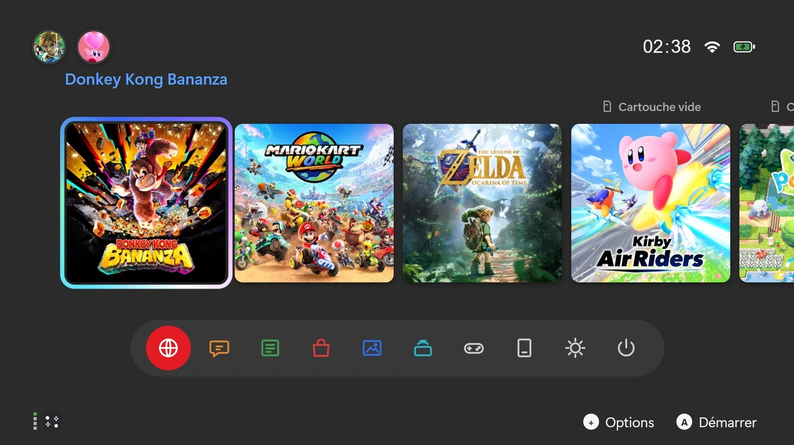
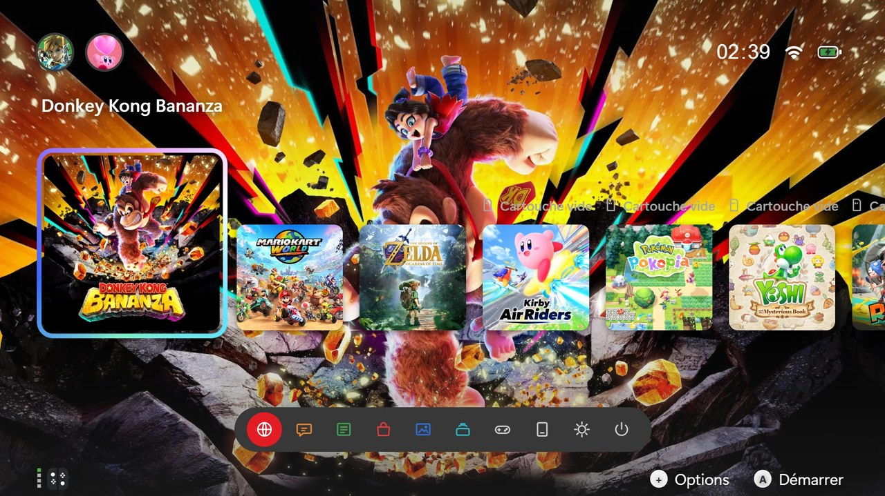
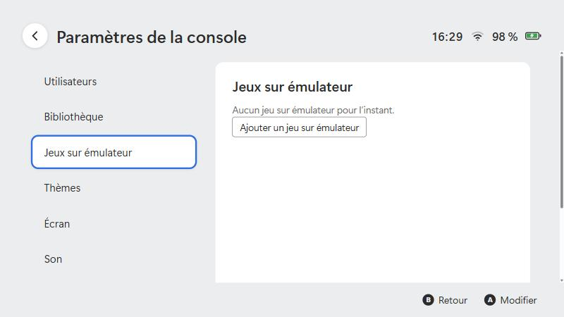

# Console Launcher

Un lanceur de jeux **plein écran** pour PC, inspiré du menu d'accueil d'une console de salon : une rangée de jeux, une barre d'icônes rondes, des profils, un album de captures, des actualités et des thèmes personnalisables.

Il lance **tes** jeux : des programmes PC « natifs », ou des jeux qui passent par un **émulateur**.

**Télécharger :** [la dernière version](https://github.com/FireXcorn/console-launcher/releases/latest) pour Windows 10 et 11 : décompresse l'archive et lance `Console Launcher.exe`, rien à installer.

<p align="center">
  <br>
  <em>Mode « Sans thème » : le menu d'origine.</em>
</p>

<p align="center">
  <br>
  <em>Mode « Image du jeu » : la grande image du jeu sélectionné derrière les jaquettes.</em>
</p>

> **À savoir.** Console Launcher est un projet indépendant. Il n'est ni affilié ni approuvé par Nintendo ou par un autre constructeur de consoles, et il ne contient aucun jeu, émulateur ou fichier de console. Les noms de marques cités dans la documentation appartiennent à leurs propriétaires. Les captures d'écran ci-dessus montrent des jaquettes et des images de jeux officielles, uniquement à titre d'illustration : elles appartiennent à leurs ayants droit et seront retirées sur simple demande.

## Ce qui est inclus, et ce qui ne l'est pas

Le lanceur est **un menu** : il lance **tes** jeux. Il fonctionne avec :

| Type | Exemples | Ce que tu fournis |
|---|---|---|
| Jeux PC natifs | Un dossier avec un `.exe` | Le dossier du jeu |
| Jeux sur émulateur | Tout émulateur qui se lance en ligne de commande | L'émulateur (site officiel) et le fichier de **ton** jeu |
| Jeux issus d'une recompilation / d'un portage | Un programme PC produit par un outil dédié | Le programme obtenu à partir de **ta** copie du jeu |
| **Jeux livrés avec leur outil** | Mario Kart World, Donkey Kong Bananza, Pokémon Pokopia, Zelda Ocarina of Time : l'outil est déjà dans l'archive | Seulement **ton** fichier de jeu : le lanceur prépare le reste |

**Aucun jeu n'est fourni.** Le dépôt ne contient aucun jeu, aucune clé ni aucun firmware. Les outils de certains jeux (voir ci-dessous) sont fournis dans l'archive de la version téléchargeable, avec leur propre licence ; le code du dépôt, lui, n'en contient aucun. Utilise uniquement des fichiers que tu possèdes légalement. Détails : [Ce qui est inclus et ce qui ne l'est pas](docs/fichiers-de-jeu.md).

## Fonctionnalités

- **Accueil en plein écran** : rangée de jeux avec curseur animé, barre de dix icônes, horloge, Wi-Fi et batterie.
- **Ajout de jeux depuis l'interface** : un bouton pour un jeu PC, un pour un jeu sur émulateur, et l'import d'un dossier entier ; un assistant au premier lancement.
- **Jeux natifs** : un dossier de jeux analysé automatiquement, avec titres et images.
- **Retour au menu depuis un jeu** : Ctrl+Alt+Q, ou Retour + Menu maintenus 2 secondes sur manette.
- **Réglages protégés** : écriture sûre, copie de secours automatique, fichier abîmé mis de côté au lieu d'être écrasé.
- **Jeux sur émulateur** : l'émulateur reste caché derrière un écran noir jusqu'à ce que le jeu tourne.
- **Fenêtre du jeu à ton image** : titre du jeu et jaquette en icône (barre des tâches, Alt+Tab), jamais le nom de l'émulateur.
- **Profils** : plusieurs utilisateurs, avec personnage, arrière-plan, pseudo et temps de jeu propres à chacun.
- **Thèmes** : fond d'écran, couleurs, tuiles, barre du bas, curseur, sons. Import et enregistrement de tes thèmes.
- **Album** : les captures d'écran faites pendant un jeu.
- **Actualités** : un flux RSS ou Atom de ton choix.
- **Jeux livrés avec leur outil** : tu ajoutes ton fichier de jeu, le lanceur prépare l'outil et le jeu devient jouable. Visite guidée au premier lancement.
- **Sauvegardes par profil** : chaque profil a ses propres sauvegardes de jeu, avec copie de secours des profils.
- **Manette et clavier** : navigation complète aux deux.
- **Démarrage automatique** avec la session (option).

## Installation rapide

**Prérequis** : Windows 10 ou 11. Pour construire depuis les sources : [Node.js](https://nodejs.org) 20 ou plus récent.

```bash
git clone https://github.com/FireXcorn/console-launcher.git
cd console-launcher
npm install
npm run dist
```

Le lanceur est alors dans `dist/win-unpacked/` : lance `Console Launcher.exe`. Détails dans [Installation](docs/installation.md).

## Premiers pas en 4 minutes

1. Télécharge l'archive, décompresse-la et lance `Console Launcher.exe`.
2. Choisis **Commencer la visite** : des bulles te montrent l'écran.
3. Les jeux livrés avec leur outil apparaissent avec la mention **Cartouche vide**. Sélectionne-en un et appuie sur **A** (ou Entrée).
4. Choisis **ton** fichier de jeu (par exemple un `.nup`), puis **Préparer le jeu**. Une barre indique l'avancement ; la préparation de certains jeux peut durer longtemps.
5. Quand c'est fini, la tuile devient un vrai jeu : sélectionne-la, appuie sur **A**, et il se lance en plein écran. `Ctrl+Alt+Q` ramène au menu.

Le guide complet est dans [Premiers pas](docs/premiers-pas.md).

## Ajouter ses jeux

Au premier lancement, un assistant te propose d'importer un dossier de jeux. Sinon :

1. Ouvre **Paramètres de la console** (l'icône en forme de soleil, dans la barre du bas) → **Ajouter des jeux**.
2. **Ajouter un jeu PC…** : choisis le programme (`.exe`) du jeu. → [Guide des jeux natifs](docs/jeux-natifs.md)
3. **Ajouter un jeu sur émulateur…** : choisis l'émulateur, puis le fichier du jeu. → [Guide des émulateurs](docs/emulateurs.md)
4. **Importer un dossier de jeux…** : le lanceur trouve un programme par sous-dossier ; tu coches ceux à ajouter.

<p align="center">
  
</p>

## Documentation

| Page | Contenu |
|---|---|
| [Premiers pas](docs/premiers-pas.md) | Le tutoriel : de l'archive téléchargée au premier jeu lancé |
| [Installation](docs/installation.md) | Télécharger ou construire l'application, premier lancement, démarrage automatique |
| [Intégrer un outil toi-même](docs/integrer-un-outil.md) | La méthode pour brancher n'importe quel émulateur ou outil de recompilation |
| [Ce qui est inclus](docs/fichiers-de-jeu.md) | Jeux, émulateurs, recompilation : ce que tu dois fournir toi-même |
| [Jeux natifs](docs/jeux-natifs.md) | Dossier des jeux, nom du programme, recompilations, titres et images |
| [Émulateurs](docs/emulateurs.md) | Ajouter un jeu sur émulateur ou recompilé, arguments, détection du démarrage |
| [Personnalisation](docs/personnalisation.md) | Profils, personnages, thèmes, sons, jaquettes, album |
| [Configuration](docs/configuration.md) | Référence complète de `config.json` |
| [Dépannage](docs/depannage.md) | Les problèmes courants et leurs solutions |
| [Publier sur GitHub](docs/publier-sur-github.md) | Mettre le projet en ligne et publier une version téléchargeable |
| [Contribuer](CONTRIBUTING.md) | Développer, tester, proposer une modification |

## Licence

Le code est publié sous licence [MIT](LICENSE). Les jeux, émulateurs, images et sons que tu ajoutes appartiennent à leurs auteurs et ne sont pas couverts par cette licence.
