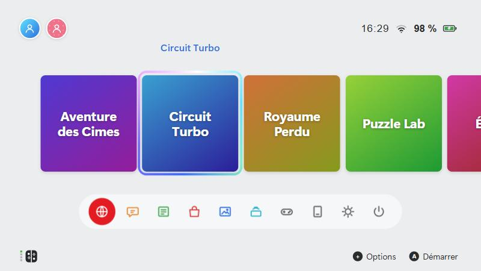

# Console Launcher

Un lanceur de jeux **plein écran** pour PC, inspiré du menu d'accueil d'une console de salon : une rangée de jeux, une barre d'icônes rondes, des profils, un album de captures, des actualités et des thèmes personnalisables.

Il lance **tes** jeux : des programmes PC « natifs », ou des jeux qui passent par un **émulateur**.

<p align="center">
  
</p>

> **À savoir.** Console Launcher est un projet indépendant. Il n'est ni affilié ni approuvé par Nintendo ou par un autre constructeur de consoles, et il ne contient aucun jeu, émulateur ou fichier de console. Les noms de marques cités dans la documentation appartiennent à leurs propriétaires.

## Ce qui est inclus, et ce qui ne l'est pas

Le lanceur est **un menu** : il lance **tes** jeux. Il fonctionne avec :

| Type | Exemples | Ce que tu fournis |
|---|---|---|
| Jeux PC natifs | Un dossier avec un `.exe` | Le dossier du jeu |
| Jeux sur émulateur | Tout émulateur qui se lance en ligne de commande | L'émulateur (site officiel) et le fichier de **ton** jeu |
| Jeux issus d'une recompilation / d'un portage | Un programme PC produit par un outil dédié | Le programme obtenu à partir de **ta** copie du jeu |

**Ce dépôt ne contient, ne distribue et ne renvoie vers aucun jeu, aucun émulateur, aucun outil de recompilation, aucune clé ni aucun firmware** : ce serait contraire au droit d'auteur. Utilise uniquement des fichiers que tu possèdes légalement. Détails : [Ce qui est inclus et ce qui ne l'est pas](docs/fichiers-de-jeu.md).

## Fonctionnalités

- **Accueil en plein écran** : rangée de jeux avec curseur animé, barre de dix icônes, horloge, Wi-Fi et batterie.
- **Jeux natifs** : un dossier de jeux analysé automatiquement, avec titres et images.
- **Jeux sur émulateur** : l'émulateur reste caché derrière un écran noir jusqu'à ce que le jeu tourne.
- **Fenêtre du jeu à ton image** : titre du jeu et jaquette en icône (barre des tâches, Alt+Tab), jamais le nom de l'émulateur.
- **Profils** : plusieurs utilisateurs, avec personnage, arrière-plan, pseudo et temps de jeu propres à chacun.
- **Thèmes** : fond d'écran, couleurs, tuiles, barre du bas, curseur, sons. Import et enregistrement de tes thèmes.
- **Album** : les captures d'écran faites pendant un jeu.
- **Actualités** : un flux RSS ou Atom de ton choix.
- **Manette et clavier** : navigation complète aux deux.
- **Démarrage automatique** avec la session (option).

## Installation rapide

**Prérequis** : Windows 10 ou 11. Pour construire depuis les sources : [Node.js](https://nodejs.org) 20 ou plus récent.

```bash
git clone https://github.com/FireXcorn/console-launcher.git
cd console-launcher
npm install
npm run dist
```

Le lanceur est alors dans `dist/win-unpacked/` : lance `Console Launcher.exe`. Détails dans [Installation](docs/installation.md).

## Ajouter ses jeux

1. Ouvre **Paramètres de la console** (l'icône en forme de soleil, dans la barre du bas).
2. Pour un jeu PC : **Bibliothèque** → choisis ton dossier de jeux et le nom du programme. → [Guide des jeux natifs](docs/jeux-natifs.md)
3. Pour un jeu sur émulateur : **Jeux sur émulateur** → ajoute le programme et le fichier du jeu. → [Guide des émulateurs](docs/emulateurs.md)

<p align="center">
  
</p>

## Documentation

| Page | Contenu |
|---|---|
| [Installation](docs/installation.md) | Construire et lancer l'application, démarrage automatique |
| [Intégrer un outil toi-même](docs/integrer-un-outil.md) | La méthode pour brancher n'importe quel émulateur ou outil de recompilation |
| [Ce qui est inclus](docs/fichiers-de-jeu.md) | Jeux, émulateurs, recompilation : ce que tu dois fournir toi-même |
| [Jeux natifs](docs/jeux-natifs.md) | Dossier des jeux, nom du programme, recompilations, titres et images |
| [Émulateurs](docs/emulateurs.md) | Ajouter un jeu sur émulateur, arguments, détection du démarrage |
| [Personnalisation](docs/personnalisation.md) | Profils, personnages, thèmes, sons, jaquettes, album |
| [Configuration](docs/configuration.md) | Référence complète de `config.json` |
| [Dépannage](docs/depannage.md) | Les problèmes courants et leurs solutions |
| [Publier sur GitHub](docs/publier-sur-github.md) | Mettre le projet en ligne et publier une version téléchargeable |
| [Contribuer](CONTRIBUTING.md) | Développer, tester, proposer une modification |

## Commandes de navigation

| Action | Clavier | Manette |
|---|---|---|
| Se déplacer | Flèches | Croix / stick |
| Valider | `Entrée` | A |
| Retour | `Échap` | B |
| Options d'un jeu | `Suppr` | Y |
| Menu / valider un écran | `Tab` | + |
| Onglet précédent / suivant | `Page haut` / `Page bas` | L / R |

## Licence

Le code est publié sous licence [MIT](LICENSE). Les jeux, émulateurs, images et sons que tu ajoutes appartiennent à leurs auteurs et ne sont pas couverts par cette licence.
