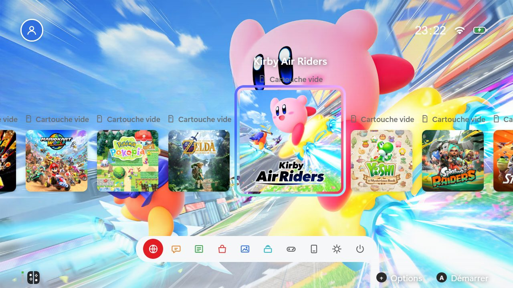
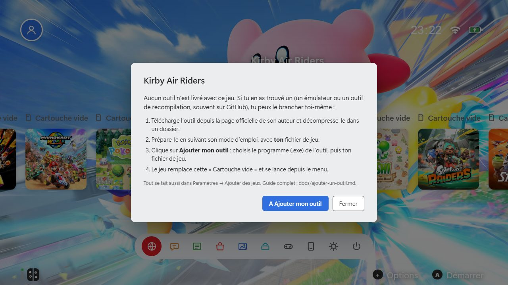
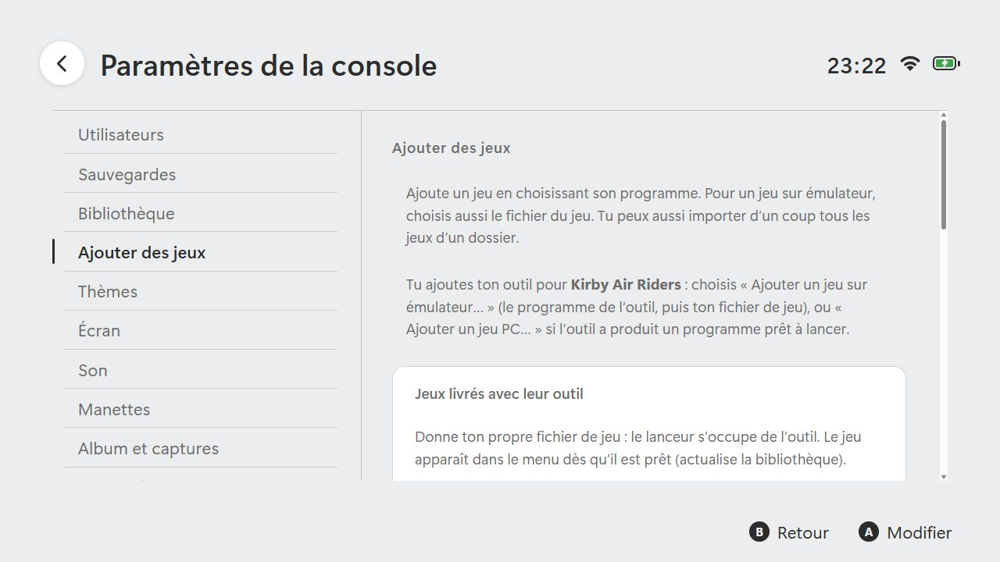
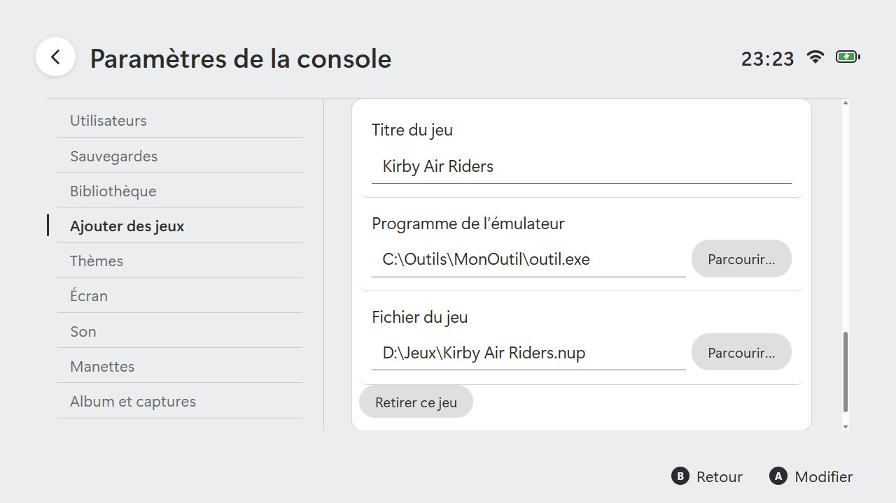

# Ajouter ton propre outil (émulateur ou recompilation)

[← Documentation](../README.md#documentation)

Quatre jeux sont déjà livrés avec leur outil ([Premiers pas](premiers-pas.md)). Pour **tous les autres** jeux du menu (Kirby Air Riders, Yoshi, Star Fox, Splatoon Raiders…), le lanceur ne fournit rien : si tu trouves un outil (un émulateur, ou un outil de recompilation, souvent sur GitHub), tu peux le brancher toi-même. Cette page le fait pas à pas, avec des captures.

> Aucun jeu, clé ni firmware n'est fourni. Utilise uniquement des fichiers que tu possèdes légalement, et des outils pris sur la page **officielle** de leur auteur.

## Ce qu'il te faut

- l'**outil**, téléchargé depuis sa page GitHub (onglet **Releases**, fichier pour Windows, souvent un `.zip`) ;
- **ton** fichier de jeu ;
- son mode d'emploi : chaque outil a le sien, lis-le d'abord.

## Étape 1 : préparer l'outil, sans le lanceur

1. Sur la page de l'outil, ouvre **Releases**, télécharge la version pour Windows et décompresse-la dans un dossier à toi (par exemple `C:\Outils\MonOutil`).
2. Suis son mode d'emploi pour qu'il fonctionne avec **ton** fichier de jeu. **Si ça ne marche pas à la main, ça ne marchera pas dans le lanceur.**
3. Selon l'outil, deux cas :
   - **Un émulateur** : il lance ton fichier de jeu directement. Note comment (par exemple `outil.exe -g mon-jeu.nup`).
   - **Un outil de recompilation** : il fabrique un **programme PC** (un `.exe`) à partir de ton jeu. Prépare-le une fois, puis garde le dossier obtenu.

## Étape 2 : trouver la tuile « Cartouche vide »

Sélectionne le jeu (par exemple Kirby Air Riders) dans le menu : sa tuile porte la mention **Cartouche vide**.

Appuie sur **A** (ou Entrée). Une fenêtre explique la marche à suivre.

Clique sur **Ajouter mon outil**.

## Étape 3 : ajouter l'outil

Tu arrives dans **Paramètres → Ajouter des jeux**, avec un rappel du jeu concerné.

Selon ton outil :

| Ton outil | Bouton | Ce que tu choisis |
|---|---|---|
| Un émulateur | **Ajouter un jeu sur émulateur…** | Le programme de l'émulateur (`.exe`), puis **ton** fichier de jeu |
| Un outil de recompilation | **Ajouter un jeu PC…** | Le programme (`.exe`) que l'outil a fabriqué |
| Plusieurs jeux déjà prêts dans un dossier | **Importer un dossier de jeux…** | Le dossier ; coche ceux à ajouter |

Une fiche apparaît : le **titre** est déjà celui du jeu, tu n'as plus qu'à vérifier les chemins.

Quitte les Paramètres : le jeu remplace la « Cartouche vide » et se lance depuis le menu.

## Étape 4 : si le jeu ne démarre pas comme prévu

Les réglages techniques sont cachés par défaut. Pour les voir : **Paramètres → Avancé → Afficher les réglages avancés**. Tu peux alors régler :

- **Arguments** : ce que l'outil attend après son nom, avec `{game}` à la place du chemin de ton jeu (par exemple `-f -g {game}`). C'est ce que tu as noté à l'étape 1.
- **La détection du lancement** : voir [Intégrer un outil](integrer-un-outil.md#étape-3--dire-au-lanceur-quand-le-jeu-tourne).

Lance la tuile. Retour immédiat au menu ? Reprends l'étape 1 : l'outil s'arrête tout seul. Le journal `launcher.log` et [Dépannage](depannage.md) t'aident à voir pourquoi.

## Conseils de sécurité

- Prends l'outil sur la page **officielle** de son auteur, jamais sur un lien reçu d'un inconnu.
- Lis sa licence et son mode d'emploi.
- Ne mets jamais de fichiers de jeu, de clés ou de firmware dans un ticket ou une discussion publique du dépôt.

## Pour aller plus loin

- La méthode complète, avec tous les réglages : [Intégrer un outil](integrer-un-outil.md).
- Faire livrer un outil avec le lanceur (recettes) : section « Jeux livrés avec leur outil » de la même page.
