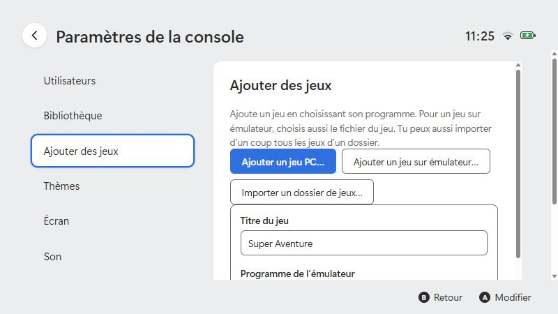

# Ajouter un jeu sur émulateur

[← Documentation](../README.md#documentation)

Pour chaque jeu, tu indiques **quel émulateur** ouvrir et **quel fichier** lui donner (un jeu à la fois : il n'y a pas encore d'import d'un dossier de fichiers de jeu). Le lanceur :

1. couvre l'écran d'un fond noir pendant le chargement ;
2. démarre l'émulateur avec ton jeu ;
3. répond « oui » aux questions habituelles (plein écran, paramètres recommandés) ;
4. retire l'écran noir dès que le jeu tourne.

> Le lanceur ne fournit ni émulateur ni jeu. Utilise des émulateurs téléchargés depuis leur site officiel et des jeux que tu possèdes et que tu as copiés toi-même. Voir [ce qui est inclus et ce qui ne l'est pas](fichiers-de-jeu.md).

<p align="center">
  
</p>

Pour apprendre la méthode complète avec n'importe quel outil : [Intégrer toi-même un outil](integrer-un-outil.md).

## Étapes

1. Installe ton émulateur et vérifie **à la main** qu'il lance bien ton jeu.
2. **Paramètres de la console → Ajouter des jeux → Ajouter un jeu sur émulateur…** : choisis le programme de l'émulateur, puis le fichier du jeu.
3. Vérifie ou complète les champs de la fiche qui apparaît :

   | Champ | À mettre |
   |---|---|
   | **Titre du jeu** | Le nom affiché sur la tuile. |
   | **Programme de l'émulateur** | **Parcourir…** puis l'`.exe` de l'émulateur. |
   | **Fichier du jeu** | **Parcourir…** puis le fichier du jeu. Pour un jeu recompilé (un programme qui se lance seul), utilise plutôt **Ajouter un jeu PC…** : il n'y a pas de fichier de jeu. |
   | **Arguments** | Les options de l'émulateur. Écris `{game}` à l'endroit où le fichier du jeu doit apparaître. Les espaces dans le chemin ne posent pas de problème. |

4. Quitte les paramètres : la tuile apparaît à l'accueil. Elle n'existe que si l'émulateur **et** le fichier du jeu sont présents aux chemins indiqués.
5. Ajoute une image : *Paramètres → Bibliothèque → Jeux → Image…* (voir [Jeux natifs](jeux-natifs.md#titres-et-images)).

## Fenêtre du jeu : titre et icône

Dès que la fenêtre de l'émulateur apparaît, le lanceur lui donne **le titre du jeu** et **sa jaquette en icône** (barre des tâches, Alt+Tab). On ne voit donc pas le nom de l'émulateur. Il peut rester visible une fraction de seconde si l'émulateur réécrit son titre. Ça vaut aussi pour les [jeux natifs](jeux-natifs.md). Un jeu sans jaquette garde l'icône par défaut.

## Quels arguments ?

Chaque émulateur a ses propres options : **lis sa documentation** (cherche « command line »). Le principe : **ce que tu taperais après le nom de l'émulateur dans une fenêtre de commandes**, avec `{game}` à la place du chemin du jeu.

Points de départ courants, **à vérifier avec ta version** :

| Émulateur | Arguments possibles |
|---|---|
| Cemu | `-f -g {game}` (valeur proposée par défaut) |
| Dolphin | `-b -e {game}` |
| PCSX2 / DuckStation | `-batch -fullscreen -- {game}` |
| RetroArch | `-L cores\ton_coeur_libretro.dll {game} -f` |
| RPCS3 | `{game}` |

## Comment le lanceur sait que le jeu tourne

Il surveille l'émulateur et retire l'écran noir quand :

- le **titre de la fenêtre** de l'émulateur correspond à une expression (par défaut : un titre qui contient au moins **trois** `|`, comme en affichent certains émulateurs une fois le jeu lancé). Si le titre de ton émulateur est différent, règle `readyTitle` (voir plus bas), par exemple `\\|\\s*Nom du jeu`, ou
- une **ligne apparaît dans le journal** de l'émulateur (si tu en as configuré un), puis une courte pause.

Si rien n'est détecté, l'écran noir se retire de toute façon après un délai de sécurité (environ 45 secondes pour un jeu émulé).

### Régler la détection pour un émulateur précis

Ces réglages avancés s'écrivent dans `config.json` (voir [Configuration](configuration.md#jeux-sur-émulateur-emulated)) :

```json
{
  "title": "Mon jeu",
  "emulatorExe": "C:\\Emu\\emulateur.exe",
  "gameFile": "D:\\Jeux\\mon-jeu.xyz",
  "args": ["-f", "-g", "{game}"],
  "readyTitle": "",
  "readyLog": "C:\\Emu\\log.txt",
  "readyPattern": "Game loaded",
  "settleMs": 3000,
  "dialogPattern": "(?i)recommended|fullscreen"
}
```

| Champ | Rôle |
|---|---|
| `readyTitle` | Expression régulière sur le titre de la fenêtre : quand elle correspond, le jeu tourne. |
| `readyLog` + `readyPattern` | Fichier journal de l'émulateur et phrase qui y apparaît quand le jeu tourne. Plus fiable que le titre. |
| `settleMs` | Pause en millisecondes entre ce signal et le retrait de l'écran noir (5000 par défaut). |
| `dialogPattern` | Les fenêtres de l'émulateur dont le texte correspond reçoivent « oui » automatiquement. |

## Retirer un jeu

*Paramètres → Ajouter des jeux →* **Retirer ce jeu**, sous sa fiche.

## Voir aussi

[Jeux natifs](jeux-natifs.md) · [Dépannage](depannage.md)
