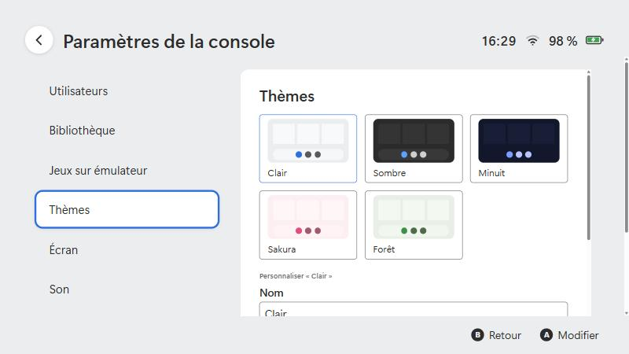

# Personnalisation

[← Documentation](../README.md#documentation)

## Profils

Plusieurs utilisateurs peuvent partager le lanceur. Chacun a son icône, son pseudo et son **temps de jeu**.

- Clique sur ton rond de profil (en haut à gauche) pour ouvrir **Ma page**.
- **Paramètres de l'utilisateur** → *Modifier l'icône*, *Modifier le pseudo*, *Activité de jeu* (voir ou remettre à zéro), *Supprimer l'utilisateur*.
- Avec plusieurs profils, le lanceur demande **qui joue** au démarrage.
- Les profils se gèrent aussi dans *Paramètres de la console → Utilisateurs*.

### Modifier l'icône

Deux onglets (`Page haut` / `Page bas`, ou L / R) :

- **Personnage** : tes images, rangées par séries (voir ci-dessous), et « Mon image ».
- **Arrière-plan** : couleurs unies, dégradés et motifs.

`Valider` (ou `Tab` / +) enregistre ; `Échap` / B annule sans rien changer.

### Tes propres personnages

Le lanceur ne contient aucun personnage. Dépose **tes** images (png, jpg, webp ; de préférence des PNG à fond transparent) dans le **dossier de personnages** (par défaut `Images\Personnages`, modifiable dans *Utilisateurs*).

```
Images\Personnages\
├─ Aventuriers\        ← une série
│   ├─ Archer.png
│   └─ Mage.png
└─ Solo.png            ← à la racine : série « Mes personnages »
```

Chaque sous-dossier devient une série ; le nom du fichier devient le nom du personnage. Utilise des images dont tu as le droit de te servir.

## Thèmes

**Paramètres de la console → Thèmes.**

<p align="center">
  
</p>

Cinq thèmes sont fournis (Clair, Sombre, Minuit, Sakura, Forêt). Pour chacun tu peux régler, **en direct** :

| Réglage | Effet |
|---|---|
| Fond d'écran + voile sombre | Image derrière l'accueil ; le voile garde le texte lisible. |
| Jeu de couleurs et 7 couleurs | Fond, panneaux, cases vides, barre du bas, icônes, texte, accent. |
| Arrondi des tuiles | De carré à très rond. |
| Barre du bas | Avec fond, ou flottante. |
| Icônes de la barre | Colorées, ou d'une seule couleur. |
| Curseur | Irisé ou uni. |
| Sons du thème | Utilise le dossier `sounds` du thème avant tes autres sons. |

Les changements s'affichent tout de suite ; **enregistre** le thème pour le garder. Un thème fourni se copie sous un nouveau nom pour être modifié.

### Format d'un thème

Un thème est un dossier dans `themes\` (dans le dossier de données du lanceur) :

```
themes\mon-theme\
├─ theme.json
├─ wallpaper.png          ← facultatif
└─ sounds\                ← facultatif
    ├─ deplacer.wav
    └─ valider.wav
```

```json
{
  "name": "Mon thème",
  "author": "Moi",
  "base": "dark",
  "colors": { "bg": "#12172b", "accent": "#7c9cff" },
  "wallpaper": "wallpaper.png",
  "wallpaperDim": 0.3,
  "tileRadius": 1.6,
  "dockStyle": "floating",
  "dockColors": "mono",
  "cursor": "solid",
  "sounds": true
}
```

| Champ | Valeurs |
|---|---|
| `base` | `light` ou `dark` : les couleurs de départ |
| `colors` | Parmi `bg`, `surface`, `slot`, `bar`, `icon`, `text`, `accent` (format `#rrggbb`) ; seules celles indiquées remplacent la base |
| `wallpaper` | Nom d'un fichier du dossier (png, jpg, webp, avif, gif ; 15 Mo maximum) |
| `wallpaperDim` | 0 à 0,7 |
| `tileRadius` | 0 à 3 |
| `dockStyle` | `bar` ou `floating` |
| `dockColors` | `color` ou `mono` |
| `cursor` | `iridescent` ou `solid` |
| `sounds` | `true` pour utiliser le dossier `sounds` |

**Partager un thème** : donne le dossier. L'autre personne clique **Importer un dossier de thème…** ; seuls `theme.json`, l'image de fond et les sons reconnus sont copiés.

## Sons

*Paramètres → Son* règle les volumes. Pour remplacer les sons, mets des fichiers (`mp3`, `ogg`, `wav`, `flac`, `m4a`) dans le **dossier de sons** :

| Fichier | Quand |
|---|---|
| `menu` | Musique de fond (aucune par défaut) |
| `deplacer` | Déplacement du curseur |
| `valider` | Validation |
| `retour` | Retour |
| `lancer` | Lancement d'un jeu |
| `refuser` | Action impossible |

## Fond du jeu sélectionné

Quand un jeu est survolé ou sélectionné, sa tuile grandit (vers le haut) et sa grande image apparaît derrière le menu en fondu.

- **Avec une grande image** : dépose dans le *Dossier des fonds de jeux* (*Paramètres de la console → Bibliothèque*, par défaut Images\Fonds de jeux) une image large nommée comme le jeu, par exemple Mario Kart World.jpg (png, jpg, webp ou avif). Elle couvre tout l'écran (recadrée au centre si elle n'est pas en 16:9). Choisis une image **sans logo** (ou recadre-la sous le logo), au format paysage et d'au moins 1920 px de large : tu peux l'agrandir avec un outil de ton choix. Pour un seul jeu, tu peux aussi indiquer un chemin précis avec overrides.<id>.backdrop dans [la configuration](configuration.md).
- **Sans grande image** : pas de fond, le menu reste uni.

Le mode se choisit dans *Paramètres de la console → Thèmes → Fond des jeux* : **Sans thème** (le menu d'origine : grosses tuiles alignées, barre du bas d'origine, pas de fond) ou **Image du jeu derrière les jaquettes** (tuiles plus petites, jeu sélectionné agrandi vers le haut, barre du bas réduite ; réglage `gameBackdrop`). Si ta grande image est au format 16:9, elle s'affiche telle quelle, sans zoom ni recadrage ; sinon elle est recadrée au centre pour couvrir l'écran.

## Jaquettes

Voir [Jeux natifs](jeux-natifs.md#titres-et-images) : image dans le dossier du jeu, dossier de jaquettes, ou choix d'une image par jeu.

## Album

Pendant un jeu, la **touche de capture** (par défaut `F12`) enregistre une capture dans le **dossier de l'album**. Ouvre l'icône *Album* de la barre pour les voir, les supprimer (corbeille) ou ouvrir le dossier. Les deux se règlent dans *Paramètres → Album et captures*.

## Actualités

*Paramètres → Actualités* : l'adresse (https) d'un flux RSS ou Atom, affiché dans l'icône *Actualités*.

## Voir aussi

[Configuration](configuration.md) · [Dépannage](depannage.md)
